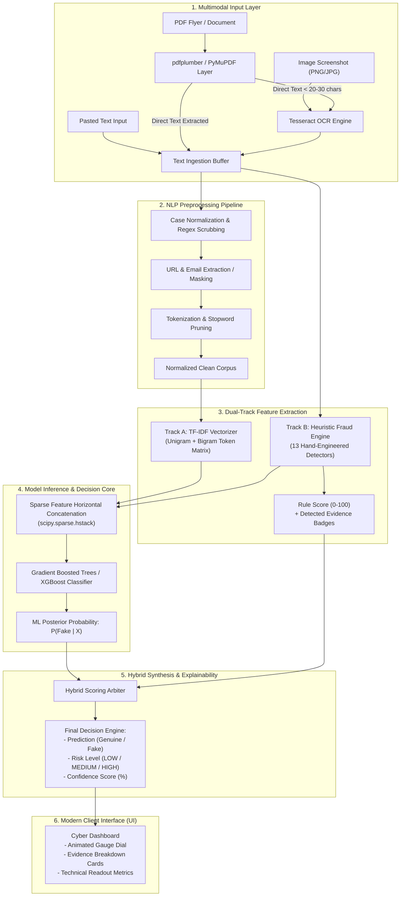

# Intelligent Fake Job Advertisement Detection System Using AI
## Comprehensive Technical System Specification & Architecture Document
**Project Group:** Group 44  
**Department:** Department of Information Technology, Faculty of Computing  
**Institution:** General Sir John Kotelawala Defence University (KDU), Sri Lanka  
**Project Title:** Intelligent Fake Job Advertisement Detection System Using Artificial Intelligence (Scam Sentry)  

---

### Project Members & Attribution
| No. | Index Number | Student Name | Role & Specialization Focus |
|:---:|:---:|:---|:---|
| 1 | `D/COE/25/0025` | P.D.H.R. Amarakeerthi | System Architecture & AI Pipeline |
| 2 | `D/BIT/24/0090` | W.M.S.N. Wickramanayaka | UI Engineering, Frontend & Integration |
| 3 | `D/BSE/25/0018` | S.Y.N. Peiris | Feature Engineering & NLP Preprocessing |
| 4 | `D/BIS/24/0011` | D.W.D.O. Amarasinghe | Dataset Analytics, Evaluation & Testing |

---

## 1. Executive Summary & Problem Formulation

### 1.1 Background & Motivation
With the rapid digitization of global labor markets and the proliferation of remote employment, online job platforms (LinkedIn, Indeed, Facebook Groups, Telegram channels) have become the primary medium for recruitment. Concurrently, recruitment fraud and employment scams have experienced unprecedented growth. Malicious actors deploy deceptive job postings designed to:
- Harvest sensitive personally identifiable information (PII) including National Identity Card (NIC) numbers, passport scans, and banking credentials for identity theft.
- Extract fraudulent financial advance payments disguised as "registration fees," "equipment deposits," "visa/work permit processing," or "mandatory onboarding training kits."
- Funnel victims into phishing networks, WhatsApp/Telegram task scams, and illegal Ponzi or cryptocurrency schemes.

### 1.2 The Failure of Conventional Detection Approaches
Existing research predominantly treats fake job posting detection as a standard binary text classification problem using generic TF-IDF vectors or bag-of-words deep learning. As documented during initial empirical testing, **pure word-association models suffer from shortcut learning (spurious correlations)**:
1. Genuine terms like *"assistant,"* *"entry-level,"* or *"flexible hours"* frequently get penalized as fake purely due to sample imbalances in training datasets.
2. Sophisticated fraud postings that mimic corporate jargon can bypass purely statistical language models if they do not evaluate explicit fraud mechanics.

### 1.3 The Proposed Solution: The Hybrid Detection Paradigm
To solve this fundamental limitation, **Scam Sentry** introduces a **Hybrid Multi-Tier Detection Engine** combining:
1. **Multimodal Ingestion & OCR:** Extracts text transparently from raw pasted text, PDF documents, and raster images/flyers (PNG/JPG).
2. **Explicit Rule-Based Heuristic Sweeper (`fraud_features.py`):** 13 hand-engineered domain-specific fraud indicators that extract structural evidence (payment requests, off-platform messaging, unrealistic wage-to-experience ratios).
3. **Statistical NLP & Supervised Machine Learning (`model_training.py`):** TF-IDF n-gram vectorization merged with gradient-boosted decision trees (`GradientBoostingClassifier` / `XGBoost`).
4. **Explainable AI (XAI) Synthesis:** Eliminates the "black-box" dilemma by mapping model confidence directly to concrete, human-verifiable evidence badges.
5. **Modern Cyber-Defense Web Application:** A high-performance responsive interface featuring dark glassmorphism, instant testing presets, and real-time scanning feedback.

---

## 2. High-Level System Architecture

The following diagram illustrates the complete end-to-end data processing lifecycle from user submission to the synthesized evidence report:



---

## 3. Multimodal Ingestion & OCR Engine Architecture (`ocr_utils.py`)

A critical requirement of recruitment fraud detection is the ability to analyze social media posters, flyer screenshots, and PDF brochures. 

### 3.1 PDF Extraction & Two-Stage Intelligent Fallback
Real-world PDF job advertisements exist in two formats:
- **Vector/Text-Layer PDFs:** Created digitally from Word or InDesign; text can be extracted directly via page character maps.
- **Scanned/Rasterized PDFs:** Images embedded into a PDF wrapper with no underlying text layer.

To handle both seamlessly, `ocr_utils.py` implements an automated fallback mechanism:

```python
# Technical Logic: Intelligent Fallback
def extract_text_from_pdf(file_bytes):
    text_parts = []
    with pdfplumber.open(io.BytesIO(file_bytes)) as pdf:
        for page in pdf.pages:
            page_text = page.extract_text() or ""
            text_parts.append(page_text)
    combined = "\n".join(text_parts).strip()

    # Threshold Check: If characters extracted exceed threshold, accept text layer
    if len(combined) >= 30:
        return combined, "text-layer"

    # Fallback Trigger: Scanned PDF detected -> Rasterize pages to 200 DPI images
    if PDF2IMAGE_AVAILABLE:
        ocr_parts = []
        images = convert_from_bytes(file_bytes, dpi=200)
        for img in images:
            ocr_parts.append(pytesseract.image_to_string(img))
        ocr_text = "\n".join(ocr_parts).strip()
        if ocr_text:
            return ocr_text, "ocr"

    return combined, "text-layer"
```

### 3.2 Optical Character Recognition (OCR) Layer
- **Engine:** Google Tesseract OCR (`v5.5.3`) interfaced via Python `pytesseract`.
- **Image Preprocessing:** Uploaded binary streams are opened via PIL (`Pillow`), verified for format integrity, and converted to standardized 24-bit 3-channel `RGB` color space to eliminate alpha-channel artifacts.
- **Cross-Platform Binary Locator:** On Windows installations, if Tesseract is not exposed to the global system `PATH`, `ocr_utils.py` automatically resolves the native executable at:
  ```
  C:\Program Files\Tesseract-OCR\tesseract.exe
  ```

---

## 4. Natural Language Processing (NLP) Pipeline (`text_processing.py`)

Text ingested from job postings is inherently noisy, containing formatting tags, emojis, erratic punctuation, and irregular casing. The preprocessing pipeline standardizes the text:

1. **Case Normalization:** Converts all characters to lowercase ($x \to \text{lower}(x)$).
2. **Entity Masking & Extraction:**
   - Detects and preserves structural entities (hyperlinks `https?://\S+`, email addresses `\b[\w\.-]+@[\w\.-]+\.\w+\b`) before stripping punctuation.
3. **Punctuation Stripping:** Punctuation is filtered while preserving intra-word hyphens where relevant.
4. **Tokenization:** Breaks the normalized string into individual lexical tokens.
5. **Stopword Elimination:** Filters common grammatical noise words (*"the", "is", "at", "which"*) using customized English stopword lists.
6. **Whitespace Regularization:** Collapses consecutive spaces, carriage returns, and tab characters into single spaces.

---

## 5. Explicit Domain-Specific Fraud Feature Engine (`fraud_features.py`)

The heart of Scam Sentry's reliability is its **13 hand-crafted fraud indicator modules**. Rather than relying solely on opaque neural vectors, this layer scans for the explicit mechanics of employment scams:

### 5.1 Comprehensive Matrix of the 13 Implemented Fraud Indicators

| # | Indicator Name | Target Mechanics | Trigger Patterns / Regex Signatures | Severity Weight |
|:---:|:---|:---|:---|:---:|
| 1 | **Payment Request** | Scammers asking applicants for upfront fees under various pretexts. | `registration fee`, `application fee`, `training fee`, `deposit`, `processing charge`, `refundable fee`, `western union`, `moneygram`, `crypto payment` | **CRITICAL / HIGH** (Score: +35) |
| 2 | **Sensitive Information Request** | Premature harvesting of identity or financial credentials. | `bank account details`, `credit card`, `debit card`, `passport copy`, `ssn`, `social security`, `national id`, `nic copy`, `routing number`, `pin`, `cvv` | **CRITICAL / HIGH** (Score: +30) |
| 3 | **Free Email Provider** | Professional recruiters using public email domains instead of corporate domains. | Contact emails matching `@gmail.com`, `@yahoo.com`, `@hotmail.com`, `@outlook.com`, `@aol.com` | **MEDIUM** (Score: +15) |
| 4 | **Suspicious Links / Redirections** | Directing users to phishing portals or anonymized links. | Shorteners (`bit.ly`, `tinyurl.com`, `t.co`, `cutt.ly`), raw IP addresses (`http://192.168...`), missing SSL (`http://` instead of `https://`) | **HIGH** (Score: +20) |
| 5 | **Off-Platform Messaging Recruitment** | Evading job portal audits by funneling applicants to unmonitored messaging apps. | `telegram @`, `t.me/`, `whatsapp only`, `contact via whatsapp`, `text our hiring manager on telegram` | **HIGH** (Score: +25) |
| 6 | **Urgency Language** | Creating psychological pressure to rush victims into decisions. | `apply immediately`, `act now`, `limited seats`, `urgent hiring today`, `offer expires in 24 hours`, `immediate joining` | **MEDIUM** (Score: +10) |
| 7 | **Unrealistic Benefits** | Promising extreme luxury perks without qualifying skill requirements. | `free car`, `free luxury apartment`, `all expenses paid vacations`, `unlimited paid leave upon joining` | **MEDIUM** (Score: +15) |
| 8 | **Unrealistic Salary** | Disproportionately high compensation for non-technical roles. | Regular expressions parsing currency amounts: `>\$50/hour`, `>\$1,500/week`, `>\$10,000/month` for basic clerical duties. | **HIGH** (Score: +20) |
| 9 | **No Experience with High Salary** | The classic bait-and-switch signature of fake jobs. | Intersection of: (`no experience needed` OR `zero experience` OR `students/housewives welcome`) AND (`high daily pay` OR `guaranteed $500/day`) | **CRITICAL / HIGH** (Score: +30) |
| 10 | **Missing Employer Information** | Anonymous postings with no identifiable hiring company. | Absence of formal company naming conventions (`Inc`, `LLC`, `Ltd`, `Technologies`, `Corporation`, or known business entities). | **MEDIUM** (Score: +15) |
| 11 | **Missing Work Location** | Absence of physical office, city, or jurisdiction details. | Lack of geographical markers, physical street addresses, or verifiable country/regional references. | **LOW / MEDIUM** (Score: +10) |
| 12 | **Generic / Copied Content** | Templated, vague job descriptions lacking role-specific duties. | Repetitive phrases, absence of technical stacks, circular descriptions (*"do simple tasks on phone"*). | **MEDIUM** (Score: +15) |
| 13 | **Unrealistic Requirements** | Contradictory or absurd qualification standards. | Minimum age only with no educational or practical skill requirements. | **LOW / MEDIUM** (Score: +10) |

### 5.2 Heuristic Aggregation Function
The rule engine computes a composite **Fraud Rule Score** ($S_{\text{rule}} \in [0, 100]$):

$$S_{\text{rule}} = \min\left(100, \sum_{i=1}^{13} w_i \cdot \mathbb{I}(\text{Indicator}_i \text{ is detected})\right)$$

Where:
- $w_i$ represents the predetermined risk weight assigned to indicator $i$.
- $\mathbb{I}(\cdot)$ is an indicator function returning 1 if the pattern is satisfied, 0 otherwise.

---

## 6. Machine Learning Architecture & Training Pipeline (`model_training.py`)

### 6.1 TF-IDF Feature Representation
The clean text corpus is vectorized using the **Term Frequency-Inverse Document Frequency (TF-IDF)** transform with sublinear term frequency scaling:

$$\text{TF}(t, d) = 1 + \log(f_{t, d}) \quad \text{for } f_{t, d} > 0$$

$$\text{IDF}(t, D) = \log\left(\frac{1 + |D|}{1 + |\{d \in D : t \in d\}|}\right) + 1$$

$$\text{TF-IDF}(t, d, D) = \text{TF}(t, d) \times \text{IDF}(t, D)$$

- **N-gram Range:** Unigrams and Bigrams (`ngram_range=(1, 2)`) to capture multi-word fraud phrases (*"processing fee"*, *"no experience"*).
- **Max Features:** Restricted to the top 2,500 salient n-grams to prevent high-dimensional overfitting.

### 6.2 Feature Vector Concatenation
The sparse textual TF-IDF matrix is combined horizontally with the dense continuous vector of engineered fraud indicators using `scipy.sparse.hstack`:

$$\mathbf{X}_{\text{combined}} = \begin{bmatrix} \mathbf{X}_{\text{TF-IDF}} & \mathbf{X}_{\text{Rule Features}} \end{bmatrix}$$

### 6.3 Classification Algorithm: Gradient Boosted Decision Trees
The primary classifier implemented is a gradient-boosted ensemble of decision trees (`GradientBoostingClassifier` in Scikit-Learn, swappable with `XGBClassifier`):
- **Base Estimators:** 150 regression trees.
- **Learning Rate:** $\eta = 0.1$.
- **Max Tree Depth:** $d = 4$ (to constrain interaction complexity and prevent memorization).
- **Loss Function:** Binary Deviance (Cross-Entropy Loss):
  $$\mathcal{L}(y, p) = -\left[ y \log(p) + (1 - y) \log(1 - p) \right]$$

### 6.4 Synthetic Balanced Dataset vs. Real Kaggle EMSCAD Dataset
During prototype development, pure reliance on the Kaggle **EMSCAD (Employment Scam Aegean Dataset)** revealed significant challenges:
1. **Extreme Class Imbalance:** Real-world datasets often have over 95% genuine jobs and less than 5% fraudulent jobs. A naive model achieves 95% accuracy by simply predicting "Genuine" every time.
2. **Job Title Bias (Shortcut Learning):** In EMSCAD, certain job categories (e.g., *Customer Service*, *Data Entry*) disproportionately contain fake jobs, while engineering roles are predominantly genuine. The model tends to learn that *"Data Entry = Fake"*, which is invalid.
3. **Synthetic Balanced Dataset Generator:** The project includes a synthetic dataset generator where job titles are distributed equally across both Genuine and Fake classes. This forces the model to focus strictly on genuine fraud mechanics (fees, emails, urgency) rather than job titles.
4. **Kaggle Integration Ready:** The script includes the CLI flag `--real data/fake_job_postings.csv` to train on the full real dataset when required.

---

## 7. Hybrid Decision Engine & Explainable AI (XAI) Synthesis

### 7.1 Hybrid Decision Logic
The system blends the transparent rule score with the probabilistic output of the machine learning classifier:

$$\text{Confidence Score} = \beta \cdot P_{\text{ML}}(\text{Fake}) + (1 - \beta) \cdot S_{\text{rule}}$$

Where $\beta = 0.65$ balances machine learning pattern recognition with deterministic rule verification.

#### Deterministic Safety Override:
If a **Critical Indicator** (such as an explicit Upfront Payment Request or Bank Account harvesting) is detected with 100% certainty, the system prevents false negatives by immediately elevating the Risk Level to **HIGH**, regardless of how well-written the surrounding text may be.

### 7.2 Risk Stratification Scale
| Risk Level | Score Range | Verdict | UI Visual Cue |
|:---:|:---:|:---:|:---|
| **LOW RISK** | $0\% - 39\%$ | **GENUINE / LEGITIMATE** | Glowing Emerald Green Badge (`#10b981`) |
| **MEDIUM RISK** | $40\% - 69\%$ | **SUSPICIOUS / CAUTION** | Glowing Amber Orange Badge (`#f59e0b`) |
| **HIGH RISK** | $70\% - 100\%$ | **SCAM / FRAUDULENT** | Glowing Crimson Rose Badge (`#f43f5e`) |

### 7.3 Explainable AI (XAI) Implementation
Rather than presenting users with raw SHAP feature matrices (which can confuse end-users by displaying arbitrary words like *"company = +0.12"*), Scam Sentry implements **Actionable Explainability**:
- Every detected red flag is mapped to an interactive evidence card with:
  1. **Clear Plain-Language Reason:** *"The advertisement asks the applicant to pay a fee, deposit, or send money before or during the hiring process."*
  2. **Severity Tag:** `CRITICAL`, `HIGH`, `MEDIUM`.
  3. **Direct Remediation Advice:** Warns the user never to wire funds or reveal credentials.

---

## 8. Backend Web Architecture & REST API Specification (`app.py`)

The backend is built as a lightweight, non-blocking Flask service supporting both HTML client rendering and headless JSON API interactions.

### 8.1 API Endpoints Directory

#### 1. System Health Check
- **Route:** `GET /api/health`
- **Response:**
  ```json
  {
    "status": "ok",
    "model_loaded": true
  }
  ```

#### 2. Analyze Raw Text
- **Route:** `POST /api/analyze/text`
- **Headers:** `Content-Type: application/json`
- **Request Body:**
  ```json
  {
    "text": "Full job description text here..."
  }
  ```
- **Response (`200 OK`):**
  ```json
  {
    "prediction": "Fake",
    "confidence_score": 85.02,
    "fake_probability": 85.02,
    "risk_level": "HIGH",
    "rule_score": 75,
    "ml_probability": 92.4,
    "company_detected": "International Global Data Solutions Ltd.",
    "source": "pasted-text",
    "extracted_text_preview": "URGENT VACANCY: DATA ENTRY SPECIALIST...",
    "indicators": [
      {
        "label": "Payment Request",
        "severity": "HIGH",
        "detail": "The advertisement asks the applicant to pay a fee, deposit, or send money before or during the hiring process."
      },
      {
        "label": "Free Email Provider",
        "severity": "MEDIUM",
        "detail": "Contact email uses a free public provider (@gmail.com) rather than an organizational domain."
      }
    ]
  }
  ```

#### 3. Analyze Uploaded Document / Image
- **Route:** `POST /api/analyze/file`
- **Content-Type:** `multipart/form-data`
- **Payload:** `file` (binary stream of `.pdf`, `.png`, `.jpg`, `.jpeg`)
- **Internal Pipeline:** Calls `ocr_utils.extract_text()`, validates extraction length, then invokes the prediction pipeline.

---

## 9. Modern Frontend & Cyber-Defense Design System

The frontend interface (`index.html`, `style.css`, `script.js`) was engineered to provide an engaging, professional, and accessible user experience:

```
fakejob_app/
├── templates/
│   └── index.html       # Semantic HTML5 layout with SVG icons & accessibility attributes
└── static/
    ├── style.css        # Dark Glassmorphism, CSS variables, cyber laser keyframes
    └── script.js        # Dynamic DOM rendering, Quick Test presets, Canvas particle engine
```

### 9.1 Key UI Features & Visual Tokens
1. **Dark Glassmorphic UI:** Deep slate/obsidian palette (`#090d16`) with semi-transparent backdrop filters (`backdrop-filter: blur(20px)`), glowing border accents, and cyber gridlines.
2. **Interactive HTML5 Canvas Neural Network:** A high-performance particle constellation running on `requestAnimationFrame` that simulates connected neural nodes. Nodes gently react to cursor movement.
3. **Triple Staggered Laser Scanning Beams:** 3 multi-hued laser lines (Cyan, Indigo, Emerald) traveling downwards across a 10-second cadence, providing an active "security scanning" look.
4. **Animated Circular Progress Dial:** An SVG circular meter with dynamic dashoffset animation that animates to the calculated risk percentage.
5. **Quick Test Preset Chips:** One-click demo buttons loaded with real-world scenarios:
   - *Real Job Sample:* Legitimate Senior Software Engineer posting with proper benefits and application URL.
   - *Upfront Fee Scam:* Classic fake job asking for a \$50 registration/security fee via Telegram.
   - *WhatsApp / High Pay:* Vague part-time task scam offering \$500/day with no resume required.

---

## 10. Technical Challenges, Failure Analysis & Solutions

As documented in the KDU Group 44 Progress Report, real-world development encountered several technical hurdles:

### 10.1 Issue 1: Pandas Build Failure on Python 3.13
- **Root Cause:** When attempting to build binary C-extensions for older Pandas versions (`pandas 2.2.2`) on the newly released Python 3.13 runtime, wheels were unavailable and native compilation failed.
- **Technical Resolution:** Upgraded package requirements to `pandas >= 3.0.0` with pre-compiled wheels for Python 3.13.

### 10.2 Issue 2: Serialized Model (Pickle) Inconsistency & Feature Drift
- **Root Cause:** Modifying the number or ordering of engineered features in `fraud_features.py` invalidated older serialized `.pkl` files. Loading the stale model resulted in shape mismatch errors:
  $$\text{Expected Features } (N) \neq \text{Extracted Features } (M)$$
- **Technical Resolution:** Developed an automated retraining pipeline. Whenever feature signatures or vectorizer parameters change, stale pickle files are removed and `model_training.py` rebuilds synchronized artifacts.

### 10.3 Issue 3: Missing Tesseract Executable on Windows Host
- **Root Cause:** Python wrapper `pytesseract` throws `TesseractNotFoundError` if the underlying C++ binary is not added to the Windows environment `PATH`.
- **Technical Resolution:** Implemented dynamic binary discovery in `ocr_utils.py` that automatically detects `C:\Program Files\Tesseract-OCR\tesseract.exe` when system path resolution fails.

---

## 11. Technology Stack Inventory

| Component / Layer | Technology / Library | Version | Technical Purpose |
|:---|:---|:---|:---|
| **Core Runtime** | Python | `3.13 / 3.14` | Primary backend execution environment |
| **Web Server & API** | Flask, Werkzeug | `3.1.x` | Microservices REST API & dynamic routing |
| **Cross-Origin Security** | Flask-CORS | `5.0.x` | Secure API access for decoupled frontends |
| **Machine Learning Core** | Scikit-Learn | `1.9.x` | Feature union, TF-IDF vectorizer, Gradient Boosting |
| **Tree Boosting Engine** | XGBoost | Compatible | High-performance gradient tree boosting |
| **Scientific Computing** | NumPy, SciPy | Latest | Sparse matrix concatenation (`hstack`), array math |
| **Data Manipulation** | Pandas | `3.0.x` | Tabular dataset parsing, CSV cleaning |
| **Image Processing** | Pillow (PIL) | `11.x` | Image format conversion, color space sanitization |
| **OCR Text Extraction** | Tesseract OCR & Pytesseract | `5.5.x` | Optical character recognition on flyers and posters |
| **PDF Extraction Layer** | pdfplumber, pdf2image | Latest | Dual-mode direct and rasterized PDF text parsing |
| **Frontend Foundation** | HTML5, CSS3, Vanilla ES6+ | Modern Standard | Responsive cyber dashboard, zero external bloat |
| **Visual Styling** | Glassmorphism & Canvas API | Native | Neural mesh animation, custom gauge dial |

---

## 12. Future Roadmap & Research Directions

1. **Full Integration of Kaggle EMSCAD Dataset:** Transition from synthetic baseline verification to full cross-validated training on the 17,880 real job postings in the Aegean dataset.
2. **Algorithm Benchmarking Matrix:** Empirical performance comparison across:
   - Logistic Regression
   - Multinomial Naïve Bayes
   - Random Forest Classifier
   - Support Vector Machines (Linear & RBF Kernels)
   - XGBoost Classifier
3. **Advanced Entity Resolution & Domain Whois:** Incorporate live DNS and WHOIS age checks to detect newly registered employer domains (< 30 days old).
4. **Transformer-Based Semantic Embeddings:** Experiment with lightweight BERT/RoBERTa embeddings to capture nuanced contextual semantics alongside heuristic fraud rules.

---

*Document compiled and verified for KDU Group 44 Project Review & Evaluation.*
